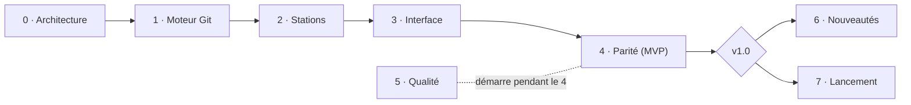

# Roadmap — Gare de triage

État au 17/11/2026. Version éditable : [doc partagé](https://claude.ai/artifact/5QLyg75i3hkUnuj1xv49dD).

## Vision et principes

Objectif : réécrire *Gare de triage* en application React maintenable, atteindre la parité avec le prototype, puis aller au-delà (conflits, défi du jour, éditeur). Le prototype `reference/artifact.html` (988 lignes, 21 stations) reste la spécification fonctionnelle et visuelle initiale qui sera surement ammenée à évoluer dans le temps; `reference/handoff.md` décrit son fonctionnement.

Point de départ au 17/11/2026 : dépôt Vite + React 19, CI GitHub Pages, shell vide. Aucun code de jeu.

Principes :

- **Moteur pur d’abord.** Le moteur Git ne connaît ni React ni le DOM. Il se teste avec `node:test`, sans navigateur.
- **Le contenu est de la donnée.** Une station = un objet décrit par un schéma, validé automatiquement (chaque station se résout avec sa solution).
- **Interface déclarative.** React rend un état ; les gestes produisent des commandes Git, jamais des mutations directes.
- **Zéro dépendance de plus sans besoin mesuré.** SVG et CSS natifs pour le rendu, pas de bibliothèque de jeu ni de gestionnaire d’état externe au départ.
- **Chaque jalon se termine par un livrable publié** sur GitHub Pages et un critère de sortie vérifiable.

## Vue d’ensemble

Les jalons 0 à 3 s’enchaînent ; la qualité (5) démarre pendant la parité (4). Nouveautés (6) et lancement (7) attendent la porte v1.0 (grille de parité cochée, 5 lignes jouables en ligne). Pas de dates : à fixer selon le temps disponible.

## Jalon 0 — Architecture et fondations

But : figer le découpage et les conventions avant d’écrire du code de jeu. Livrable : une arborescence vide mais câblée, et un document d’architecture court.

Découpage proposé :

| Dossier | Rôle | Dépend de |
| --- | --- | --- |
| `src/engine/` | Moteur Git pur : état, commandes, signatures, voie de garage | rien |
| `src/levels/` | Stations (données), lignes, outils autorisés, règles de victoire | `engine` |
| `src/game/` | Session de jeu : coups, étoiles, budget, chrono, annulation | `engine`, `levels` |
| `src/ui/` | Composants React : plateau, terminal, plan du réseau, fenêtres | `game` |
| `src/theme/` | Jetons CSS, typographie, mode sombre | rien |

Tâches :

- [ ] Valider le découpage ci-dessus (ou l’ajuster) et le consigner dans `docs/architecture.md`.
- [x] Choisir le modèle d’état : `useReducer` + contexte React, état du moteur immuable (clone par commande).
- [ ] Choisir JavaScript + JSDoc ou TypeScript (voir Décisions ouvertes).
- [x] Fixer les conventions : langue du code (anglais) et du contenu (français), nommage, format des commits.
- [x] Ajouter un lint minimal (oxlint, config React par défaut du modèle Vite) et `tsc` dans la CI.
- [x] Prévoir l’internationalisation des textes : tous les libellés dans un seul module, même si seul le français existe.

Critère de sortie : `npm test`, `npm run lint` et `npm run build` passent en CI ; le découpage est documenté et validé par le propriétaire.

## Jalon 1 — Moteur Git pur et testé

But : réécrire le moteur du prototype (§ 4.1 du handoff) en module autonome, couvert par des tests unitaires. Livrable : `src/engine/` + ses tests, aucune interface.

Statut au 17/11/2026 : **fait, en attente de relecture.** `src/engine/` (moteur + `messages.ts`) et tests par famille de commandes ; le rejeu des 21 stations est passé dans `src/levels/stations.test.ts` au jalon 2.

1. Modèle d’état : commits `{id, parents, label, origin, kind, cargo}`, voies, HEAD, `origin`, reflog, quai (`pending`), drapeaux `allow` / `noM` / `noForce`. Limites du prototype (3 voies, 8 positions de reflog) rendues configurables.
2. Analyse de commande : `exec(state, ligne)` renvoie `{state, output}` ou une erreur, sans mutation (atomicité par construction, plus besoin de clone + restauration).
3. Commandes, par ordre d’apparition dans le jeu :
    1. `commit`, `branch`, `switch` / `checkout` (`-c`, `-b`)
    2. `merge` (fast-forward ou jonction), `rebase`
    3. `cherry-pick`, `reset` (`--soft`, `--hard`, `--mixed`, `HEAD~n`, `X^`, `voie@{n}`), `revert`
    4. `push` (refus non fast-forward, `--force`), `pull` (`--rebase`), `fetch`, `_coll`
    5. `reflog`, `log`, `status`, `help`
4. Fonctions dérivées : `orphans()` (voie de garage), `sig()` (signature de victoire, modes `shape` / `raw` / exact), `gate()` (commandes pas encore au programme).
5. Tests : un fichier par famille de commandes, plus des cas d’erreur (push rejeté, force refusé, jonction interdite, référence inconnue).

Critère de sortie : toutes les commandes du tableau ci-dessus testées ; les commandes `start` et `target` des 21 stations du prototype s’exécutent sans erreur.

## Jalon 2 — Format des stations et contenu

But : décrire une station comme une donnée lisible, puis porter les 5 lignes et 21 stations du prototype. Livrable : `src/levels/` et un test qui joue chaque station.

Statut au 17/11/2026 : **fait, en attente de relecture.** `src/levels/index.ts` (schéma, lignes, règles, `startBoard`, `isWon`, `play`, `validate`), `src/levels/stations.ts` (les 21 stations, seul fichier à toucher pour en ajouter une), `src/levels/stations.test.ts`.

Écarts avec la liste ci-dessous :

- `type` vaut `compo`, `rules` ou `predict` ; un pronostic porte `answer` et `wrong` (deux `{ commands, why }`). Champs ajoutés : `id` (identifiant stable, clé de progression), `brief`, `learn`, `cargo`.
- `noMerge` / `noForce` deviennent `fastForwardOnly` / `forceForbidden`, les noms du moteur : `noMerge` est déjà le nom d’un prédicat de règle.
- `tools` devient `tool` (outil sélectionné à l’arrivée) ; les outils débloqués viennent de la ligne.
- Le test exige `solution` = `par` coups exactement (pas ≤), pour repérer aussi un `par` trop généreux. Il vérifie aussi qu’aucune station n’est gagnée dès le départ.
- Textes portés tels quels, espaces simples avant « : ? ! » : l’espace insécable revient à l’interface (jalon 3).

- [x] Schéma de station avec des noms explicites : `line`, `title`, `type` (`compo`, `rules`, `predict`), `difficulty`, `start`, `target` ou `rules`, `par`, `budget`, `timeLimit`, `keyboardOnly`, `noMerge`, `noForce`, `match`, `tools`, `newTools`, `hint`, `solution`. Les noms courts du prototype (`ch`, `diff`, `noM`…) disparaissent.
- [x] Règles de victoire en prédicats nommés et réutilisables (`contains`, `noCargo`, `noMerge`, `reverted`, `same`).
- [x] Validation du schéma au chargement : champ manquant ou incohérent = erreur explicite en développement.
- [x] Portage des 21 stations, ligne par ligne, avec relecture des textes (accords, vocabulaire ferroviaire du § 6 du handoff). Aucune faute d’accord relevée ; relecture du propriétaire au jalon 4.
- [x] Test de contenu : chaque station se résout avec `solution` en ≤ `par` coups ; chaque pronostic a une bonne réponse et deux fausses.
- [x] Lignes et outils : déblocage par ligne (`ALLOW` / `TOOLSET` du prototype) décrit dans les données, pas dans le code.

Critère de sortie : 21 stations portées, test de contenu vert ; ajouter une station ne demande de toucher qu’un fichier de données.

## Jalon 3 — Interface

But : reconstruire l’interface du prototype en composants React qui lisent l’état de la session. Livrable : une station jouable de bout en bout, puis toutes.

Statut au 17/11/2026 : **fait, en attente de relecture** (branche `jalon-3`, partie de `jalon-2`). `src/game/` (session, gestes), `src/ui/` (composants, `layout.ts`, `typography.ts`, `progress.ts`, `strings.ts`, `app.css`), `src/theme/theme.css` (tous les jetons du prototype).

Vérifications : tests `node:test` (chaque station gagnée en `par` au clavier par le réducteur, 15 stations gagnées par leurs gestes, échec de budget, chrono, pronostic, atomicité d’un geste) ; dans Chrome, stations gagnées pour six types sur sept (composition, règlement, pronostic, panne, clavier seul, contre la montre), le budget serré vérifié par son échec (fenêtre, annulation) ; gestes glisser, toucher puis toucher, soudure, voiture inverse, voie de garage ; Échap répété sans effet sur les fenêtres ; clair et sombre, pas de défilement horizontal à 390 et 400 px, console sans erreur.

Écarts avec la liste ci-dessous :

- Identité visuelle refaite après le portage (demande du propriétaire, interface jugée trop « générée ») : thème clair épuré, Barlow (signalétique ferroviaire) et IBM Plex Mono pour le terminal, pancartes en plaques émaillées, jaune signal réservé à HEAD (nez de la motrice). Le critère « fidèle au prototype » ne vaut donc plus pour le visuel, seulement pour le comportement.
- Plateau en SVG pur (voies avec traverses, aiguillages, voitures, motrice redessinées) ; `layout(state)` reste pur et testé (`src/ui/layout.test.ts`).
- Déplacements animés, sans jamais quitter les rails : une voiture ou la motrice ne roule que le long de sa voie ; une voiture nouvelle ou recréée (rebase, cherry-pick, soudure) est attelée sur place ; la motrice qui change de voie avance, s’efface et réapparaît sur la nouvelle voie. Butoir à gauche, voie ouverte à droite : le train part vers origin en accélérant. Dans l’en-tête, le train recule sur sa voie depuis la sortie. Le plateau suit la motrice sur un écran étroit. Tout est coupé avec `prefers-reduced-motion`.
- Les gestes sont traduits par `game/gestures.ts` (pur, testé) ; un geste refusé à mi-chemin est annulé en entier (`levels.runStep`, partagé avec le test de contenu).
- Pas de contexte React : l’état descend par props depuis `App.tsx`.
- Fenêtres en `<dialog>` natif ; Échap ignoré pour ne pas laisser le joueur sans issue.
- Progression sous `gare3.progress`, étoiles par `id` de station ; « Tout débloquer » gardé pour la parité (retrait au jalon 4).
- Le « doigt » n’a été vérifié qu’en simulation (événements pointeur) ; essai sur appareil réel au jalon 5. Les voitures ne sont toujours pas focalisables : au clavier, on joue par le terminal (dette connue, jalon 5).

1. **Thème** : reprendre tels quels les jetons `:root` du prototype (couleurs, livrées, mode sombre), les trois polices et la gouttière mobile.
2. **Plateau** (`<Yard>`) : calcul de disposition pur (`layout(state)` → positions), rendu SVG des voies, aiguillages, butoirs ; voitures et motrice en composants. Le même composant sert au plateau, à l’objectif miniature, aux pronostics et à l’illustration d’en-tête.
3. **Textes des stations** : espaces insécables français avant « : ? ! » appliquées au rendu.
4. **Terminal** : champ `$ git`, historique ↑ / ↓, suggestions cliquables par ligne, erreurs en rouge.
5. **Gestes** : glisser (rebase, merge, cherry-pick) et toucher (souder, revert) en Pointer Events, seuil 8 px, repli « toucher puis toucher ». Chaque geste écrit les commandes Git équivalentes dans le terminal.
6. **Session et progression** : coups, étoiles, budget, chrono, annuler, indice ; `localStorage` en try/catch (nouvelles clés versionnées).
7. **Écrans** : en-tête illustré, plan du réseau (5 lignes), tableau des départs, poste d’aiguillage, fenêtres de victoire et d’échec (`<dialog>` natif).

Critère de sortie : les 7 types de défis jouables à la souris, au doigt et au clavier ; rendu visuellement fidèle au prototype en clair et en sombre.

## Jalon 4 — Parité avec le prototype (MVP)

But : rien de ce que faisait le prototype ne manque. Livrable : version 1.0 publiée sur GitHub Pages ; le prototype n’est plus qu’une archive.

- [ ] Grille de parité : reprendre la liste du § 7 du handoff (21 stations, gestes, échecs, console propre, 390 / 400 px) et cocher chaque point dans la nouvelle version.
- [ ] Retirer « Tout débloquer » de la production (gardé derrière un paramètre d’URL en développement).
- [ ] Favicon et métadonnées de partage dans `static/`.
- [ ] Relecture complète des textes par le propriétaire.
- [ ] Tag `v1.0.0` et note de version.

Critère de sortie : grille de parité entièrement cochée ; un joueur termine les 5 lignes sur le site publié sans rencontrer de bug bloquant.

## Jalon 5 — Qualité

But : corriger la dette connue du prototype (§ 8 du handoff) et verrouiller la non-régression. Peut démarrer en parallèle du jalon 4 pour les tests de bout en bout.

| Chantier | Problème actuel | Cible |
| --- | --- | --- |
| Tests de bout en bout | Script Playwright perdu | Playwright en CI : les 21 stations jouées au clavier et aux gestes |
| Mobile | Train long : la motrice sort de l’écran | Recentrage automatique sur la motrice, plateau compact, test sur appareils réels |
| Accessibilité | Voitures non focalisables ; contraste non audité | Voitures navigables au clavier, annonces ARIA des coups, audit WCAG 2.2 AA |
| Mouvement | Seul le départ du train respecte `prefers-reduced-motion` | Toutes les animations coupées si demandé |
| Performance | Non mesurée | Lighthouse ≥ 90 sur mobile, bundle surveillé en CI |

Critère de sortie : Playwright vert en CI, audit d’accessibilité sans défaut bloquant, jeu terminé sur un téléphone réel sans défilement horizontal de la page.

## Jalon 6 — Nouveautés

But : enrichir le jeu au-delà du prototype, par ordre de valeur pédagogique. Chaque fonctionnalité est livrée séparément, derrière la parité (jalon 4).

| Priorité | Fonctionnalité | Ce qu’il faut | Touche |
| --- | --- | --- | --- |
| Haute | Conflits de fusion | Deux voitures qui touchent le même chargement ; résolution pendant un merge ou un rebase ; nouvelle ligne de stations | moteur, contenu, interface |
| Haute | Ligne 6 : nouvelles notions | `stash`, `tag`, `rebase -i` (réordonner, supprimer), `bisect` | moteur, contenu |
| Moyenne | Défi du jour | Plateau généré depuis une graine (date), score partageable en texte | moteur, interface |
| Moyenne | Éditeur de stations | Composer `start` / `target` / `rules` dans l’interface, export JSON, lien de partage | contenu, interface |
| Moyenne | Classement d’une classe | Nécessite un stockage partagé, donc un backend : à évaluer seulement si un formateur le demande | infra |
| Basse | Sons et animations | Départ, aiguillage, soufflet ; coupés par `prefers-reduced-motion` et un bouton muet | interface |

Critère de sortie, par fonctionnalité : tests moteur et contenu verts, station(s) de démonstration jouable(s), publication.

## Jalon 7 — Lancement

But : donner au jeu un nom définitif et le faire connaître. Le choix du nom peut se faire tôt ; la diffusion attend les jalons 4 et 5.

- [ ] Trancher le nom (candidats : Aiguillage, Sur la bonne voie, Gare de triage, Correspondance, TGit, Terminus, Rail Git) après vérification des noms de domaine et des marques.
- [ ] Logo final et page d’accueil (présentation, capture, bouton « Jouer »).
- [ ] Domaine personnalisé pointé sur GitHub Pages (optionnel).
- [ ] Licence du code et du contenu.
- [ ] Diffusion : formateurs Git, communautés francophones de développeurs, écoles.

Critère de sortie : nom et domaine arrêtés, page d’accueil en ligne, première annonce publique faite.

## Risques et décisions ouvertes

Décisions à prendre par le propriétaire, avant ou pendant le jalon 0 :

- [ ] **JavaScript + JSDoc ou TypeScript ?** Recommandation : TypeScript pour le moteur et le schéma de station, où les types attrapent le plus d’erreurs.
- [x] **Rendu du plateau : SVG pur ou HTML + SVG comme le prototype ?** SVG pur, retenu à la refonte visuelle du jalon 3.
- [ ] **Langue de l’interface** : français seul pour la 1.0, anglais plus tard ?
- [ ] **Nom du jeu** : nécessaire au plus tard au jalon 7, utile dès maintenant pour le dépôt et le domaine.

Risques :

| Risque | Effet | Parade |
| --- | --- | --- |
| Le moteur réécrit diverge du prototype | Stations insolubles ou trop faciles | Test de contenu (jalon 2) + grille de parité (jalon 4) |
| Gestes tactiles fragiles | Jeu frustrant sur mobile | Repli « toucher puis toucher » dès le jalon 3, tests Playwright tactiles |
| Conflits de fusion trop complexes à représenter | Jalon 6 qui s’étire | Maquette papier et une seule station pilote avant d’étendre |
| Périmètre qui gonfle avant la 1.0 | 1.0 jamais publiée | Toute nouveauté attend la parité (jalon 4) |

Dépendances : 0 → 1 → 2 → 3 → 4 ; le jalon 5 commence pendant le 4 ; les jalons 6 et 7 suivent la 1.0, le choix du nom (7) peut se faire à tout moment.
